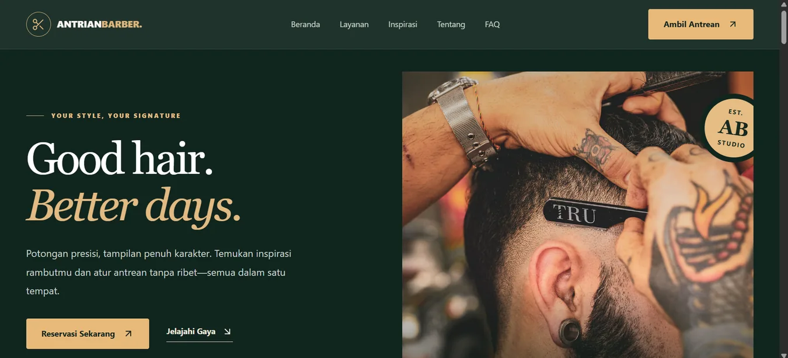
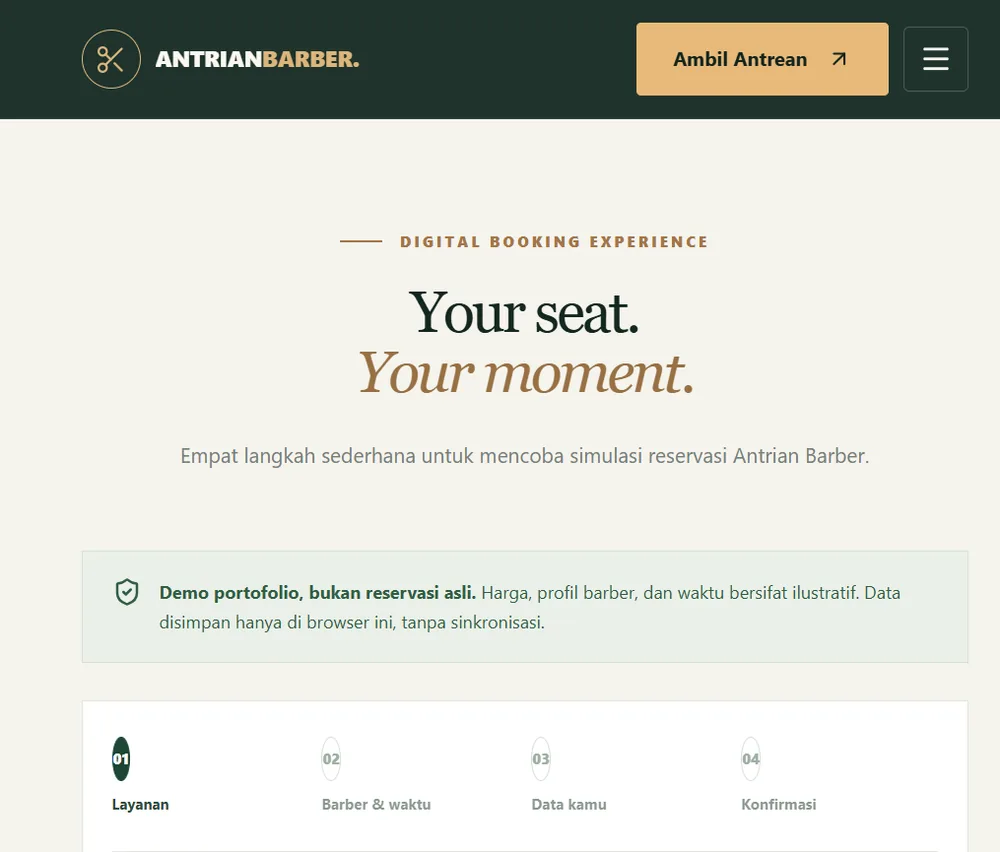

# Antrian Barber — Reservation Platform

**A modern barbershop booking experience built with React and TypeScript.**

[](https://react.dev/) [](https://vite.dev/) [](https://playwright.dev/)

Antrian Barber transforms an early web-programming project into a responsive, multi-page reservation demo. Visitors can explore grooming services, view barber profiles, browse hairstyle inspiration, and complete a four-step booking flow.

> **Project status — Frontend demo (v2.1e).** Reservations are saved only in the current browser using `localStorage`. There is no shared queue, real-time availability, payment processing, or active barbershop service. All staff profiles, prices, schedules, and tickets are illustrative. Please use fictional customer information.



*Screenshot of the locally running customer website; no public deployment is claimed.*

## What it does

- **Separate customer-facing pages:** Home, Services, Barbers, Inspiration, About, FAQ, and Reservation.
- **Reusable layout:** shared navigation and footer with responsive mobile menu.
- **Service catalog:** service descriptions, example prices and durations, with a direct path into booking.
- **Barber selection:** illustrative profiles and preselection from the barber directory.
- **Interactive inspiration gallery:** filterable hairstyle references.
- **Four-step booking wizard:** service → barber and preferred schedule → demo customer information → confirmation.
- **Demo tickets:** client-side ticket creation, local persistence after refresh, duplicate-check logic, and cancellation.
- **Usability details:** client-side validation, accessible control labels, and a route for unknown URLs.



## Tech stack

| Layer | Technology | Purpose |
| --- | --- | --- |
| UI | React, TypeScript | Component-based frontend and type safety |
| Tooling | Vite | Development server and production builds |
| Styling | Tailwind CSS, project CSS | Responsive layouts and design tokens |
| Routing | React Router | Independent page routes and shared layout |
| Icons | Lucide React | UI iconography |
| Storage (demo) | Browser `localStorage` | Local-only booking state |
| Testing | Playwright, Chromium | End-to-end navigation, booking and mobile checks |
| Audit | Chrome Lighthouse | Lab-based performance, accessibility, best practices and SEO checks |

## Getting started

**Requirements:** Node.js and npm compatible with the project's `package.json`. Tested locally using Node.js **24.21.0**, npm **11.19.0**, and Vite **8.3.6**.

```bash
# Clone and install
git clone https://github.com/Rangggase/antrianbarber-reservation-platform.git
cd antrianbarber-reservation-platform
npm ci

# Development server
npm run dev
```

Open the local address shown in the terminal (normally `http://localhost:5173/`).

**Production preview**

```bash
npm run build
npm run preview
```

`npm run preview` normally serves the compiled app at `http://localhost:4173/`.

**End-to-end tests**

```bash
npm install
npx playwright install chromium
npx playwright test --project=chromium --workers=1
npx playwright show-report
```

The Playwright configuration starts its own local test server. Do not upload customer data to this demo.

## Routes

| Page | Route |
| --- | --- |
| Home | `/` |
| Services | `/layanan` |
| Barber profiles | `/barber` |
| Inspiration | `/inspirasi` |
| About | `/tentang` |
| FAQ | `/faq` |
| Booking | `/reservasi` |
| Unknown paths | Not-found page |

## Verification snapshot

| Check | Latest reported result | Context |
| --- | --- | --- |
| Manual user acceptance tests | **10/10 passed** | Developer-performed scenarios, not external-user UAT |
| Playwright E2E | **19/19 passed** | Local Chromium, 7 November 2026 |
| Lighthouse — Home | **100 / 95 / 100 / 92** | Performance / Accessibility / Best Practices / SEO |
| Lighthouse — Booking | **99 / 96 / 100 / 91** | Performance / Accessibility / Best Practices / SEO |

The two reported Lighthouse audits used different device modes, but the per-page Mobile/Desktop mapping has not been confirmed. Scores are lab estimates and can change between runs. See the [quality-assurance evidence](docs/qa/TEST_REPORT.md) for scope and limitations.

## Architecture and project notes

- [Frontend architecture](docs/ARCHITECTURE.md)
- [QA evidence and test results](docs/qa/TEST_REPORT.md)
- [Portfolio case study](docs/PORTFOLIO_CASE_STUDY.md)
- [Development roadmap](docs/ROADMAP.md)
- [Release notes — v2.1e](docs/releases/v2.1e.md)

## What's next

The next phase replaces browser-only ticket storage with a backend using FastAPI, PostgreSQL, SQLAlchemy and Alembic, followed by a protected admin dashboard. **These capabilities are planned, not yet implemented in this frontend release.**

## Project background

This is an independently developed learning and portfolio project, evolved from an introductory web-programming assignment. It demonstrates frontend engineering, UX decisions, and quality assurance. It is not affiliated with an operating barbershop.
