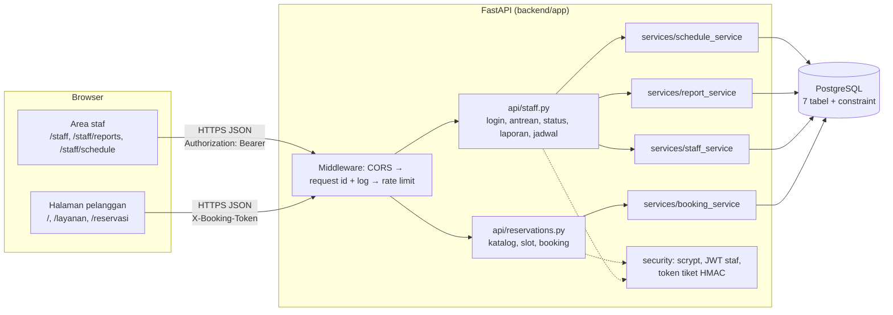
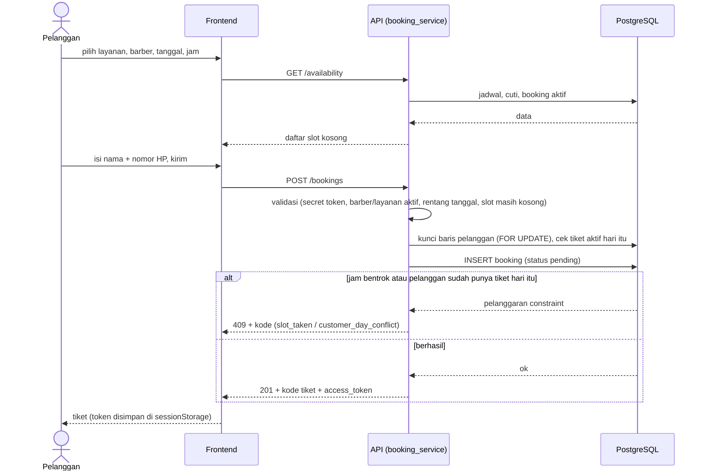
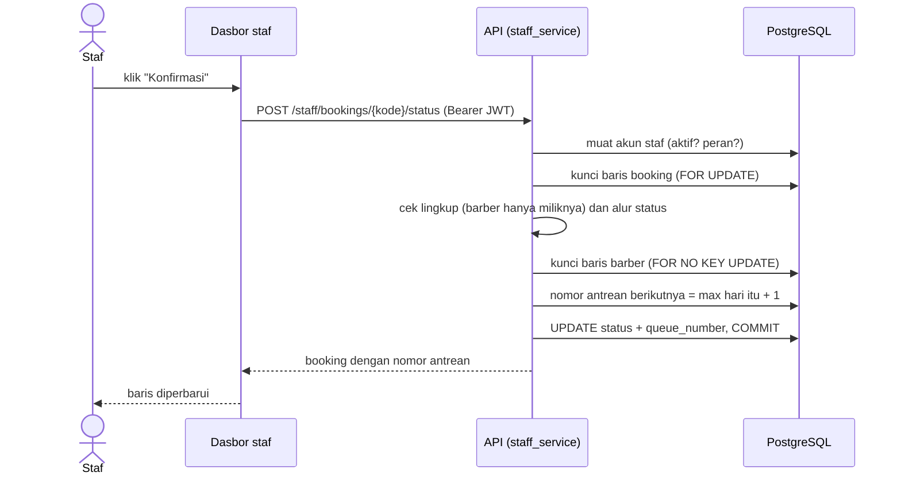

# Arsitektur — Antrian Barber

Monorepo dengan dua aplikasi: `frontend/` (React + TypeScript + Vite) dan `backend/` (FastAPI + SQLAlchemy + PostgreSQL). Dokumen khusus frontend ada di [`frontend/docs/ARCHITECTURE.md`](../frontend/docs/ARCHITECTURE.md), skema database di [DATABASE.md](DATABASE.md).

## Gambaran sistem

Frontend memilih sumber data saat build: `VITE_DATA_SOURCE=demo` (default, data di `localStorage`, tanpa backend) atau `api`. Area staf hanya berfungsi pada mode API.

## Alur 1 — pelanggan membuat booking

Pengecekan di aplikasi memberi pesan yang ramah dan lebih cepat; **constraint database** adalah penjaga terakhir sehingga dua permintaan bersamaan tidak bisa sama-sama lolos.

## Alur 2 — staf mengonfirmasi booking

## Keputusan desain

| Keputusan | Alasan |
| --- | --- |
| Aturan penting dipaksakan di database, bukan hanya di kode | Tetap benar untuk permintaan bersamaan dan penulis lain (skrip, fitur masa depan) |
| Konfirmasi serentak diserialkan dengan kunci baris barber | Tanpa itu, banyak konfirmasi bersamaan saling kalah memperebutkan satu nomor dan sebagian gagal 409 padahal sah (ditemukan tes konkurensi) |
| Tiket pelanggan memakai token HMAC, bukan akun | Pelanggan tidak perlu mendaftar; kode tiket saja tidak cukup untuk membaca data |
| Staf memakai JWT pendek dengan secret terpisah; akun dimuat ulang tiap request | Menonaktifkan akun langsung berlaku, bukan menunggu token kedaluwarsa |
| Password di-hash dengan scrypt dari pustaka standar | Tanpa dependensi native tambahan; parameter disimpan per hash agar bisa dinaikkan |
| Respons API publik tidak memuat nama atau nomor HP | Data pribadi hanya untuk staf yang sudah login, dengan `Cache-Control: no-store` |
| Format error seragam `{detail, code, request_id}` | `detail` tetap string untuk frontend; `code` stabil untuk logika dan tes |
| Log tidak memuat nama, nomor HP, token, atau query string | Mengurangi kebocoran data pribadi lewat log |
| Jadwal mingguan diganti utuh; cuti ditolak bila masih ada booking aktif | Sederhana dipahami; tidak ada pelanggan yang diam-diam ditinggalkan |
| Laporan dihitung di Python, bukan SQL khusus PostgreSQL | Perilaku sama di tes SQLite dan PostgreSQL; volume demo kecil |

## Pengujian

| Lapisan | Alat | Cakupan |
| --- | --- | --- |
| Backend, cepat | pytest + SQLite in-memory | Aturan bisnis, keamanan, format error, laporan, jadwal |
| Backend, database asli | pytest + PostgreSQL (`*_test`) | Exclusion constraint, indeks unik, migrasi bolak-balik, balapan konkurensi |
| Frontend | Playwright (Chromium) | Alur demo dan shell (29), area staf (14), build produksi memakai API (3), mock API (5), sistem desain (12) |
| CI | GitHub Actions | pytest (SQLite + PostgreSQL), lint dan build frontend |

Tes Playwright memakai mock API yang menulis header CORS sendiri, jadi kecocokan CORS nyata hanya dibuktikan tes backend.

## Batasan yang diketahui

- Rate limiter ada di memori satu proses; deployment multi-proses memerlukan penyimpanan bersama.
- Belum ada penguncian akun setelah banyak percobaan login (baru pembatasan per klien).
- Token staf disimpan di `sessionStorage` (rentan terhadap XSS bila ada celah injeksi).
- Nomor HP disimpan apa adanya; belum ada penghapusan otomatis. Gunakan data fiktif.
- Belum ada notifikasi, pembayaran, atau deployment publik; CI belum pernah dijalankan di GitHub.
- Skor Lighthouse dan hasil UAT berasal dari rilis frontend v2.1e.
