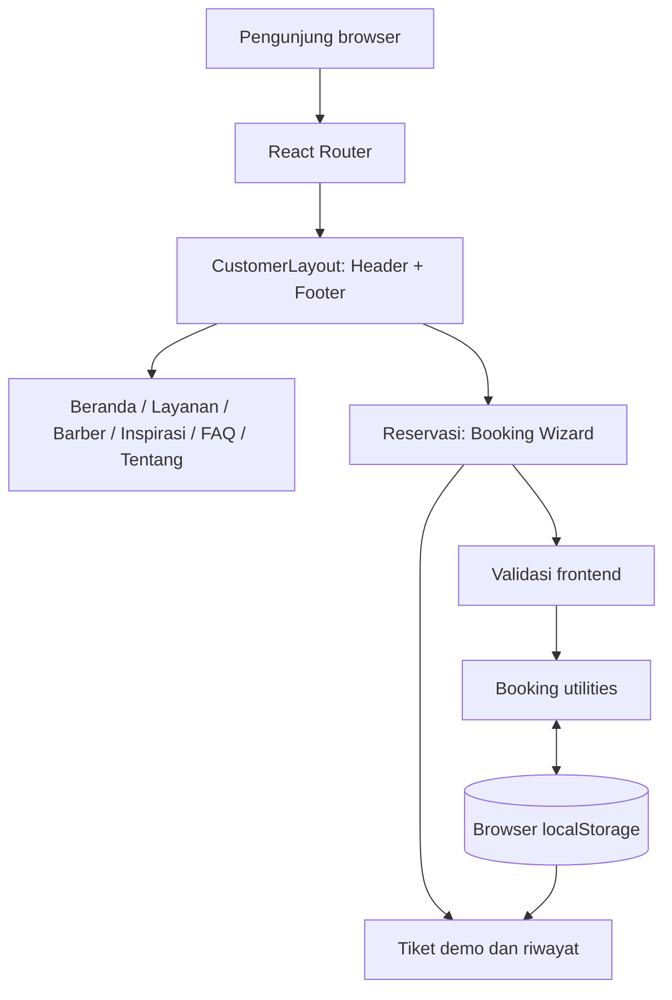
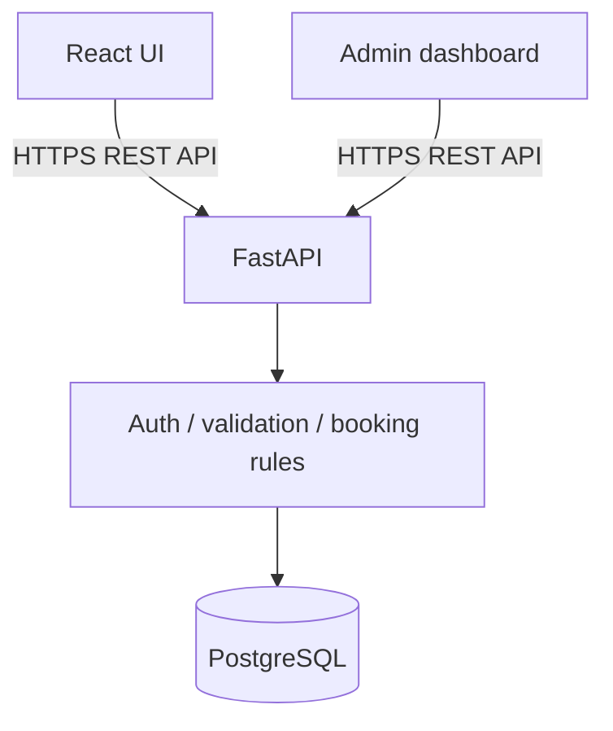

# Frontend Architecture — v2.1e

## Scope

Saat ini repositori berisi aplikasi frontend React. Belum ada layanan API, autentikasi, maupun PostgreSQL yang terhubung. Istilah "reservation" pada UI adalah simulasi lokal.



### Struktur relevan

```text
src/
├── App.tsx                 # route definitions and shared customer layout
├── components/             # reusable customer UI / booking wizard
├── pages/                  # page-level views
├── data/                   # sample services and barber profiles
├── lib/bookings.ts         # booking validation and demo storage
├── styles/                 # CSS refinements
└── main.tsx                # app entry point / router setup
e2e/                        # Playwright end-to-end scenarios
public/                     # static assets / fallback images
```

### Routes

`/`, `/layanan`, `/barber`, `/inspirasi`, `/tentang`, `/faq`, `/reservasi`, dan halaman 404.

### Alur reservasi demo

1. Memilih layanan.
2. Memilih barber ilustratif, tanggal, dan jam preferensi.
3. Mengisi nama dan nomor HP **fiktif** serta persetujuan penggunaan demo.
4. Melihat ringkasan, mengonfirmasi, lalu memperoleh tiket lokal.
5. Tiket dapat dibaca kembali dari browser yang sama dan dibatalkan.

### Batasan penting

- Data tersimpan lokal per browser/perangkat. Browser lain tidak melihat tiket yang sama.
- Slot yang ditampilkan adalah preferensi demo, bukan inventaris slot terpusat.
- Nomor tiket dan pengecekan duplikasi hanya berlaku dalam ruang lingkup penyimpanan browser tersebut.
- `localStorage` bukan penyimpanan aman untuk informasi pribadi. Selama fase demo, gunakan data sintetis.
- Tidak ada backend, database terpusat, autentikasi admin, atau notifikasi yang aktif.
- Beberapa foto menggunakan sumber gambar eksternal; tampilan dapat berubah saat koneksi offline.

### Rencana integrasi berikutnya (belum diimplementasikan)



Rancangan relasi tabel, migrasi Alembic, aturan konflik booking, dan otorisasi admin akan diputuskan pada tahap backend terpisah. Diagram kedua adalah **target arsitektur**, bukan implementasi saat ini.
