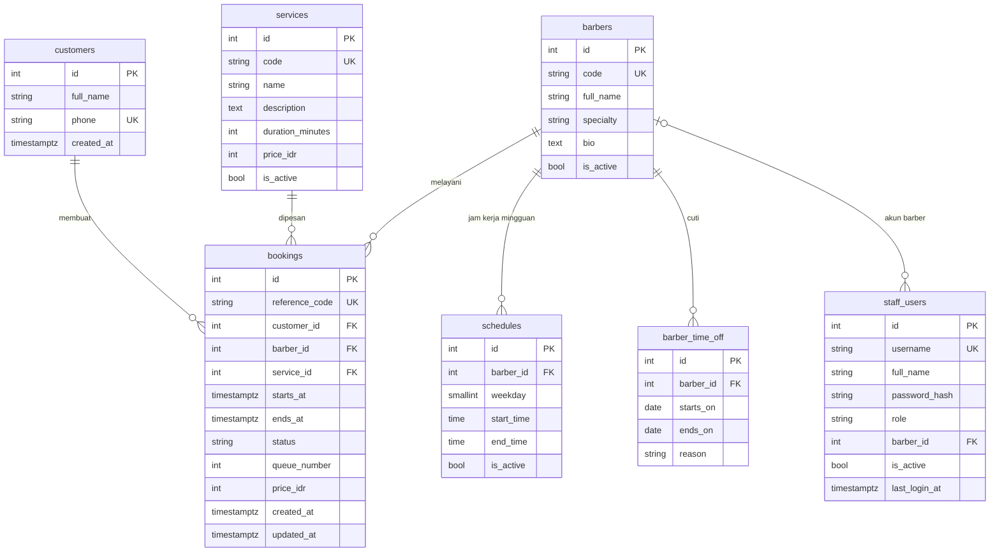
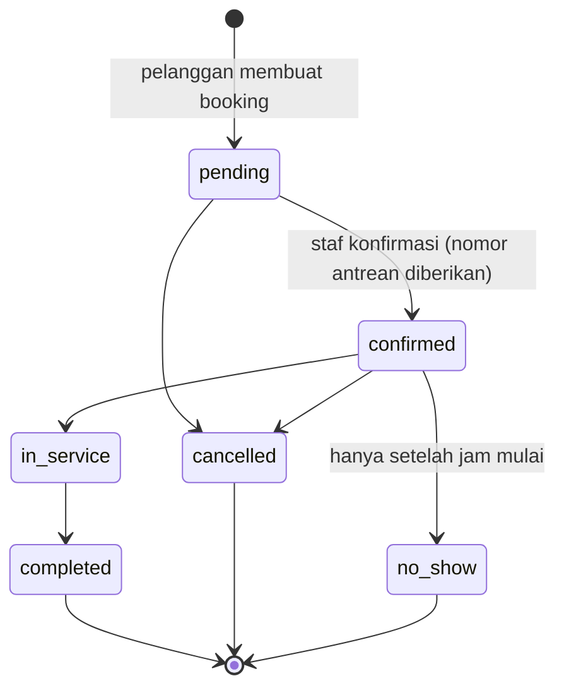

# Database — Antrian Barber

PostgreSQL, dikelola dengan SQLAlchemy 2 dan Alembic (`backend/alembic/versions/`). Tujuh tabel.

## ERD

## Aturan yang dijaga database

Aturan bisnis penting tidak hanya dicek di kode aplikasi, tetapi juga dipaksakan oleh PostgreSQL sehingga tetap benar di bawah permintaan bersamaan dan untuk penulis data mana pun.

| Aturan | Mekanisme | Hanya PostgreSQL |
| --- | --- | :---: |
| Satu barber tidak boleh punya dua booking aktif yang waktunya tumpang tindih | Exclusion constraint `ex_bookings_barber_time_overlap` (`btree_gist`, `tstzrange(starts_at, ends_at, '[)')`, hanya status `pending`, `confirmed`, `in_service`, `completed`) | ya |
| Satu pelanggan hanya punya satu booking aktif per hari kalender WIB | Indeks unik parsial `uq_bookings_customer_local_day_active` pada `(customer_id, (starts_at AT TIME ZONE 'Asia/Jakarta')::date)` | ya |
| Nomor antrean unik per barber per hari WIB | Indeks unik parsial `uq_bookings_barber_local_day_queue` (hanya baris yang punya `queue_number`) | ya |
| Nomor HP pelanggan unik | `uq_customers_phone` | tidak |
| Status booking hanya salah satu dari enam nilai; waktu mulai < selesai; harga ≥ 0 | `CHECK` constraint | tidak |
| Peran staf `admin` atau `barber`; akun `barber` wajib terhubung ke satu barber, `admin` tidak | `ck_staff_users_allowed_role`, `ck_staff_users_barber_link` | tidak |
| Cuti: tanggal akhir ≥ tanggal awal | `ck_barber_time_off_valid_range` | tidak |
| Barber, layanan, dan pelanggan tidak bisa dihapus selama masih dipakai booking | Foreign key `ON DELETE RESTRICT` | tidak |

Aturan yang ditandai "ya" diuji pada PostgreSQL asli (`backend/tests/test_postgres_integration.py`); tes SQLite tidak menjangkaunya.

## Status booking

Pelanggan sendiri hanya dapat membatalkan booking yang masih `pending` atau `confirmed` dan belum dimulai. Status `cancelled` dan `no_show` melepaskan slot (tidak ikut exclusion constraint).

## Waktu dan zona

- Semua waktu absolut (`starts_at`, `ends_at`, `created_at`) disimpan sebagai `TIMESTAMPTZ` (UTC).
- Jam kerja barber (`schedules.start_time`, `end_time`) adalah jam dinding lokal `Asia/Jakarta` tanpa zona, dan cuti (`starts_on`, `ends_on`) adalah tanggal lokal.
- "Hari" pada aturan per pelanggan, nomor antrean, antrean harian, dan laporan selalu hari kalender WIB, bukan hari UTC. Contoh: booking pukul 00:30 WIB jatuh pada tanggal UTC sebelumnya, tetapi dihitung sebagai hari WIB yang sama dengan booking pukul 20:00 WIB.

## Data pribadi

Tabel `customers` menyimpan nama dan nomor HP apa adanya, sebab staf perlu menghubungi pelanggan. Belum ada penghapusan atau anonimisasi otomatis. Proyek ini adalah demo portofolio: gunakan data fiktif. API publik tidak pernah mengembalikan nama atau nomor HP; hanya staf yang sudah login yang dapat melihatnya.
