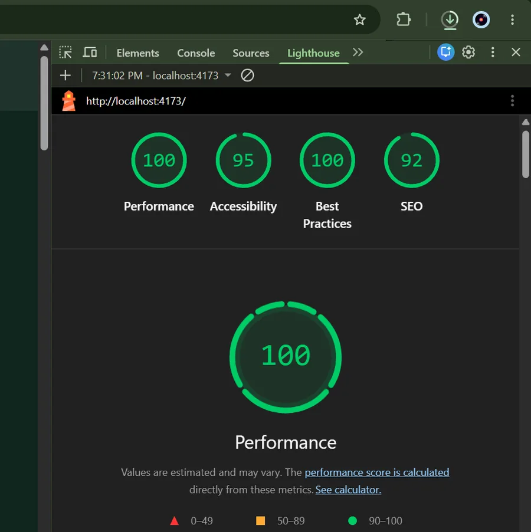
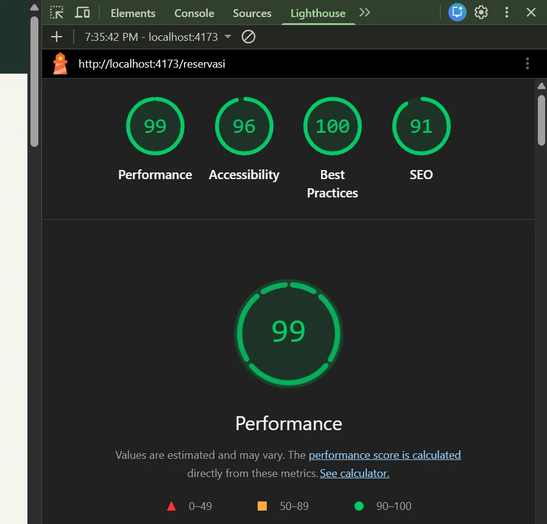

# Quality Assurance — Antrian Barber Frontend v2.1e

**Tanggal pengujian yang dilaporkan:** 7–8 November 2026 (WIB)  
**Basis bukti:** output terminal dan screenshot yang disediakan pengembang. Laporan ini bukan hasil audit independen.

## 1. Build

Build `tsc -b && vite build` berhasil pada proyek frontend menggunakan Vite 8.3.6. Pengujian terakhir setelah Hotfix 02 menunjukkan seluruh suite Playwright lulus.

## 2. Manual user acceptance tests (UAT)

**Hasil: 10/10 lulus**, diuji oleh pengembang proyek sendiri. Belum ada peserta eksternal atau pengujian bisnis nyata.

| ID | Skenario | Status |
| --- | --- | --- |
| TC01 | Navigasi multi-page | Lulus |
| TC02 | Profil barber | Lulus |
| TC03 | Filter galeri interaktif | Lulus |
| TC04 | Booking wizard empat langkah | Lulus |
| TC05 | Validasi formulir | Lulus |
| TC06 | Pembuatan tiket demo | Lulus |
| TC07 | Persistensi tiket setelah refresh | Lulus |
| TC08 | Pembatalan antrean demo | Lulus |
| TC09 | Booking melalui katalog layanan | Lulus |
| TC10 | Responsive design | Lulus |

## 3. Playwright automated testing

**Hasil akhir: 19 passed, 0 failed** (Chromium lokal, `--workers=1`).

Cakupan pengujian:

- Navigasi/routing dan halaman 404.
- Pilihan layanan/barber dari katalog serta filter galeri.
- Validasi wizard, pembuatan tiket, persistensi setelah refresh, pembatalan, dan pencegahan duplikasi dalam simulasi lokal.
- Navigasi mobile dan pengukuran horizontal overflow pada viewport pengujian.

Riwayat perbaikan: pengujian awal 15/19; kemudian 17/19 setelah perbaikan mobile; lalu 19/19 setelah pembaruan alur dan skrip Booking Wizard. Hasil ini hanya menyatakan suite yang dijalankan lulus, bukan tidak adanya semua bug.

Perintah reproduksi:

```bash
npm ci
npx playwright install chromium
npm run build
npx playwright test --project=chromium --workers=1
npx playwright show-report
```

## 4. Lighthouse — production preview lokal

Pengujian di `http://localhost:4173`, setelah `npm run build` dan `npm run preview`.

| Halaman | Performance | Accessibility | Best Practices | SEO |
| --- | ---: | ---: | ---: | ---: |
| Beranda `/` | **100** | **95** | **100** | **92** |
| Reservasi `/reservasi` | **99** | **96** | **100** | **91** |

**Batasan laporan:** kedua hasil di atas berasal dari mode perangkat yang berbeda, tetapi hasil per halaman belum diidentifikasi secara pasti sebagai Mobile atau Desktop. Empat kombinasi Beranda/Reservasi × Mobile/Desktop belum seluruhnya dilaporkan sebagai pengujian terpisah. Jangan menyebutnya empat audit.

Screenshot bukti:





### Catatan interpretasi

- Lighthouse adalah estimasi laboratorium; bukan hasil Real User Monitoring.
- Lighthouse Accessibility tidak menggantikan pengujian keyboard, screen reader, dan audit manual WCAG.
- Pengujian dilakukan terhadap demo lokal, belum terhadap deployment produksi.
- Validasi slot terpusat, perlindungan data pribadi, dan autentikasi belum diuji karena fitur tersebut belum ada.

## 5. Tahap QA selanjutnya

- Lengkapi hasil Lighthouse Mobile dan Desktop untuk kedua halaman secara terpisah.
- Tambahkan pengujian lintas browser (Firefox/WebKit) dan perangkat nyata.
- Evaluasi aksesibilitas keyboard dan screen reader secara manual.
- Jalankan kembali seluruh tes setelah integrasi backend API.
