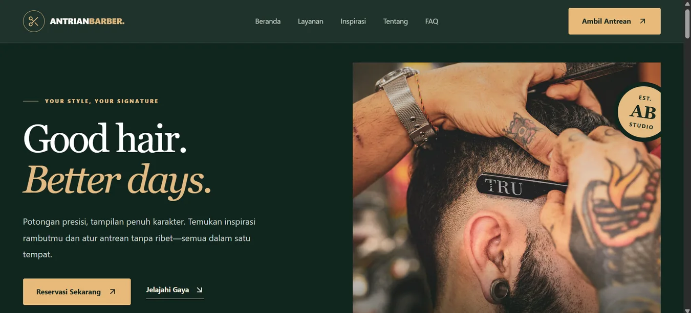
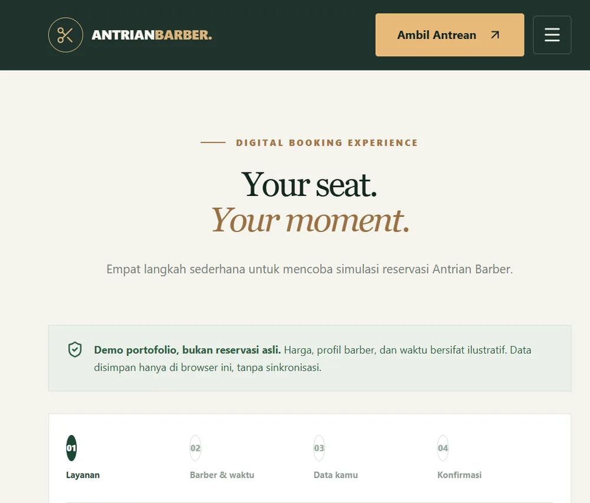

# Antrian Barber — Reservation Platform

**A modern barbershop booking experience built with React and TypeScript.**

[](https://react.dev/) [](https://vite.dev/) [](https://playwright.dev/)

Antrian Barber transforms an early web-programming project into a responsive, multi-page reservation demo. Visitors can explore grooming services, view barber profiles, browse hairstyle inspiration, and complete a four-step booking flow.

> **Project status — Fullstack demo (v2.4, in development).** The UI works in two modes. In **demo mode** (default, and the only mode in production builds) reservations are saved only in the current browser using `localStorage`. In **API mode** (`VITE_DATA_SOURCE=api` plus `VITE_API_BASE_URL`, in dev or at build time; see `.env.example`) the UI uses the FastAPI backend in `../backend` for catalog, availability and bookings. The default stays demo mode until a backend is deployed. A staff area (`/staff/login`, API mode only) lets admins and barbers confirm bookings, run the queue and see queue numbers; customers see their queue number and estimated wait under "Antreanku". There is no payment processing or active barbershop service. All staff profiles, prices, schedules, and tickets are illustrative. Please use fictional customer information.



*Screenshot of the locally running customer website; no public deployment is claimed.*

## What it does

- **Separate customer-facing pages:** Home, Services, Barbers, Inspiration, About, FAQ, and Reservation.
- **Reusable layout:** shared navigation and footer with responsive mobile menu.
- **Service catalog:** service descriptions, example prices and durations, with a direct path into booking.
- **Barber selection:** illustrative profiles and preselection from the barber directory.
- **Interactive inspiration gallery:** filterable hairstyle references.
- **Four-step booking wizard:** service → barber and preferred schedule → demo customer information → confirmation.
- **Demo tickets:** client-side ticket creation, local persistence after refresh, duplicate-check logic, and cancellation.
- **Usability details:** client-side validation, accessible control labels, and a route for unknown URLs.



## Tech stack

| Layer | Technology | Purpose |
| --- | --- | --- |
| UI | React, TypeScript | Component-based frontend and type safety |
| Tooling | Vite | Development server and production builds |
| Styling | Tailwind CSS, project CSS | Responsive layouts and design tokens |
| Routing | React Router | Independent page routes and shared layout |
| Icons | Lucide React | UI iconography |
| Storage (demo) | Browser `localStorage` | Local-only booking state |
| Testing | Playwright, Chromium | End-to-end navigation, booking and mobile checks |
| Audit | Chrome Lighthouse | Lab-based performance, accessibility, best practices and SEO checks |

## Getting started

**Requirements:** Node.js and npm compatible with the project's `package.json`. Tested locally using Node.js **24.21.0**, npm **11.19.0**, and Vite **8.3.6**.

```bash
# Clone and install
git clone https://github.com/Rangggase/antrianbarber-reservation-platform.git
cd antrianbarber-reservation-platform/frontend
npm ci

# Optional: choose demo or API mode
cp .env.example .env.development.local

# Development server
npm run dev
```

For API mode, start the backend first (see [backend/README_SETUP.md](../backend/README_SETUP.md)).

Open the local address shown in the terminal (normally `http://localhost:5173/`).

**Production preview**

```bash
npm run build
npm run preview
```

`npm run preview` normally serves the compiled app at `http://localhost:4173/`.

**End-to-end tests**

```bash
npm install
npx playwright install chromium
npx playwright test --project=chromium --workers=1
npx playwright show-report
```

The Playwright configuration starts its own local test server. Do not upload customer data to this demo.

## Routes

| Page | Route |
| --- | --- |
| Home | `/` |
| Services | `/layanan` |
| Barber profiles | `/barber` |
| Inspiration | `/inspirasi` |
| About | `/tentang` |
| FAQ | `/faq` |
| Booking | `/reservasi` |
| Unknown paths | Not-found page |

## Verification snapshot

| Check | Latest reported result | Context |
| --- | --- | --- |
| Manual user acceptance tests | **10/10 passed** | Developer-performed scenarios, not external-user UAT |
| Playwright E2E | **63/63 passed** | Local Chromium, 15 November 2026: demo 29, availability 2, bookings 3, production API 3, staff 14, UI kit 12 |
| Lighthouse — Home, Desktop | **100 / 100 / 100 / 92** | Performance / Accessibility / Best Practices / SEO. Median of 3 runs, Lighthouse 12.6.1, production preview, 15 November 2026 (after Sprint 5 and the local hero image) |
| Lighthouse — Home, Mobile | **95 / 100 / 100 / 92** | Same setup. Was 80 (LCP ≈ 4.7 s) while the hero photo loaded from an external host; now LCP ≈ 2.6 s with a local webp |
| Lighthouse — Booking, Desktop | **100 / 100 / 100 / 91** | Same setup |
| Lighthouse — Booking, Mobile | **97 / 100 / 100 / 91** | Same setup |

These replace the v2.1e figures (Home 100 / 95 / 100 / 92, Booking 99 / 96 / 100 / 91), whose device modes were never confirmed. Scores are lab estimates measured on a developer machine and can change between runs. See the [quality-assurance evidence](docs/qa/TEST_REPORT.md) for scope and limitations.

## Architecture and project notes

- [Frontend architecture](docs/ARCHITECTURE.md)
- [Design system: tokens, components, and the Sprint 5 plan](../design-system/MASTER.md) (before and after audit in `design-system/audit/`)
- [QA evidence and test results](docs/qa/TEST_REPORT.md)
- [Portfolio case study](docs/PORTFOLIO_CASE_STUDY.md)
- [Development roadmap](docs/ROADMAP.md)
- [Release notes — v2.1e](docs/releases/v2.1e.md)

## What's next

The backend (FastAPI, PostgreSQL, SQLAlchemy, Alembic) and API-mode integration exist, including production builds. Planned next: PostgreSQL-backed tests, a protected admin/barber dashboard with queue status management, and reporting. See the [roadmap](docs/ROADMAP.md).

## Project background

This is an independently developed learning and portfolio project, evolved from an introductory web-programming assignment. It demonstrates frontend engineering, UX decisions, and quality assurance. It is not affiliated with an operating barbershop.
